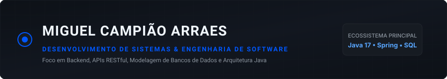

# Miguel Campião Arraes

<div align="center">



**Desenvolvimento de Sistemas • Backend • APIs RESTful • Arquitetura de Software**

> *"A engenharia de software sólida nasce da clareza arquitetural, disciplina técnica e compromisso contínuo com a excelência."*

---

[](https://github.com/miguelcampiaoarraes)
[](https://www.linkedin.com/in/miguel-campiao-arraes/)
[](mailto:miguelcampiaoarraes1905@gmail.com)

</div>

---

## 📌 Perfil Profissional

Desenvolvedor em formação técnica em **Desenvolvimento de Sistemas pelo SENAI** e acadêmica de **Ensino Médio pelo SESI**, com atuação prática no desenvolvimento de aplicações backend, construção e integração de **APIs RESTful**, modelagem de **bancos de dados relacionais (PostgreSQL/SQL)** e organização de projetos sob arquitetura em camadas.

Meu foco central é aprofundar competências em engenharia de software, orientando soluções para alta confiabilidade, manutenibilidade e boas práticas de código utilizando o ecossistema **Java** e **Spring Boot**.

---

## 🎓 Formação Acadêmica e Desenvolvimento Profissional

### Formação Acadêmica
- **SESI — Serviço Social da Indústria**  
  *Ensino Médio* • Formação acadêmica de nível médio com ênfase em raciocínio lógico e formação cidadã.

- **SENAI — Serviço Nacional de Aprendizagem Industrial**  
  *Desenvolvimento de Sistemas* • Habilitação profissionalizante abrangendo lógica de programação, desenvolvimento orientado a objetos, arquitetura de sistemas, bancos de dados relacionais, ciclo de vida de software e trabalho em equipe ágil.

### Certificações e Capacitações
- **Cisco Networking Academy — English for IT 1**  
  *Concluído* • Capacitação em língua inglesa aplicada à Tecnologia da Informação, consolidando vocabulário técnico e terminologias de engenharia de software, redes e infraestrutura.

- **Cisco Networking Academy — English for IT 2**  
  *Concluído* • Aprofundamento em comunicação técnica e profissional em inglês, com foco em compreensão de especificações de sistemas, documentações e comunicação corporativa.

- **Cisco Networking Academy — Introduction to Artificial Intelligence**  
  *Concluído* • Estudo estruturado dos fundamentos, conceitos fundamentais, casos de uso e aplicações de Inteligência Artificial em contextos tecnológicos modernos.

- **DIO + Itaú — Bootcamp Java com Inteligência Artificial**  
  *Em andamento* • Programa intensivo focado no ecossistema Java moderno, padrões de desenvolvimento backend, programação orientada a objetos e integração prática de inteligência artificial em serviços de software.

### Conquistas Acadêmicas e Atividades Relevantes
- 🏅 **Medalha de Honra ao Mérito** — Olimpíada Internacional de Matemática Kanguru.
- 🛡️ **Hack e Ética (SENAI, 2025)** — Participação técnica em maratona voltada a cibersegurança, ética da informação e boas práticas no desenvolvimento tecnológico.
- ⚙️ **Projeto Integrador Stokio** — Desenvolvimento em equipe do sistema integrado de controle patrimonial, gestão de kits pedagógicos e agendamentos para o FabLab do SENAI Petrópolis.

---

## 💻 Competências Técnicas (Hard Skills Auditadas)

Estrutura de competências baseada estritamente na análise de código-fonte dos projetos desenvolvidos:

### 1. Tecnologias Utilizadas em Projetos (Comprovadas em Código)
```text
Backend & APIs:       Java 17, Spring Boot 3, Spring Data JPA, Spring Web MVC, RESTful APIs, Swagger / OpenAPI 3
Bancos de Dados:      PostgreSQL, H2 Database (in-memory), SQL (DDL, DML, DQL, Views, Constraints)
Lógica & POO:         Programação Orientada a Objetos, Arquitetura em Camadas (Controller-Service-Repository)
Ferramentas & Build:  Git, GitHub, Apache Maven (mvnw), VS Code
Frontend Básico:      HTML5, CSS3
```

### 2. Tecnologias em Desenvolvimento de Conhecimento
```text
Automação & Scripts:  Python, JavaScript
Conteinerização:      Docker (Dockerfile, conteinerização de serviços)
Testes:               JUnit 5, Spring Boot Starter Test (testes de integração/unidade)
Game Development:     Godot Engine 4, GDScript
Deploy & Cloud:       Render (configuração via render.yaml)
```

### 3. Tecnologias em Estudo
```text
Inteligência Artificial:  Integração de IA com aplicações Java (Bootcamp DIO/Itaú e Cisco AI)
Arquitetura Avançada:     Microsserviços, Clean Architecture, Padrões de Projeto (GoF)
Bancos Não Relacionais:   Conceitos de NoSQL e mensageria
```

---

## 🚀 Projetos em Destaque

| Projeto | Descrição Técnica | Stack Tecnológica | Repositório |
| :--- | :--- | :--- | :---: |
| **Gerenciador Stokio**<br>*(Projeto Integrador SENAI)* | Sistema de controle de estoque de materiais em tempo real, gestão de kits de aprendizado e agendamento de laboratórios do FabLab SENAI Petrópolis. Conta com arquitetura em camadas completa e documentação via OpenAPI/Swagger. | `Java 17` `Spring Boot 3` `PostgreSQL` `Spring Data JPA` `Swagger UI` `Docker` | [Acessar](https://github.com/miguelcampiaoarraes/Gerenciador-Stokio) |
| **Rental Events API** | API RESTful projetada para gerenciamento completo de locação e movimentação de equipamentos de eventos. Implementa regras de negócio para status de equipamentos, usuários cadastrados e controle de histórico. | `Java 17` `Spring Boot 3` `PostgreSQL` `Hibernate` `REST API` `Swagger` | [Acessar](https://github.com/miguelcampiaoarraes/Rental_Events) |
| **Concessionária SQL**<br>*(db_revenda_miguel)* | Modelagem relacional completa para gestão de revenda de veículos. Implementa integridade referencial estrita (PKs, FKs compostas), Check Constraints de negócio e Views analíticas para vendas e estoque. | `SQL` `PostgreSQL / MySQL` `Relational Modeling` `Data Integrity` `Views` | [Acessar](https://github.com/miguelcampiaoarraes/carro-trabalho-debora) |
| **Onde Tudo Começou** | Jogo narrativo em pixel art 2D desenvolvido com lógica de cenas modulares, design sonoro e servidor Python integrado para execução multiplataforma. | `Godot 4` `GDScript` `Python` `Docker` `Pixel Art 2D` | [Acessar](https://github.com/miguelcampiaoarraes/jogodoisanos) |

---

## 📊 Estatísticas do GitHub

<div align="center">


&nbsp;


</div>

---

## 🎯 Objetivos Profissionais e Áreas de Interesse

- **Aprofundamento Backend:** Desenvolver soluções corporativas robustas, escaláveis e seguras utilizando Java, ecossistema Spring e bancos de dados relacionais.
- **Engenharia de Software:** Aplicar princípios de código limpo, testes automatizados e arquitetura de software para resolver problemas reais de negócios.
- **Crescimento Técnico Contínuo:** Evoluir constantemente através de projetos práticos, desafios algorítmicos e capacitações de ponta.

---

<div align="center">

Desenvolvido com foco em qualidade técnica e clareza • **Miguel Campião Arraes** • 2026

</div>
